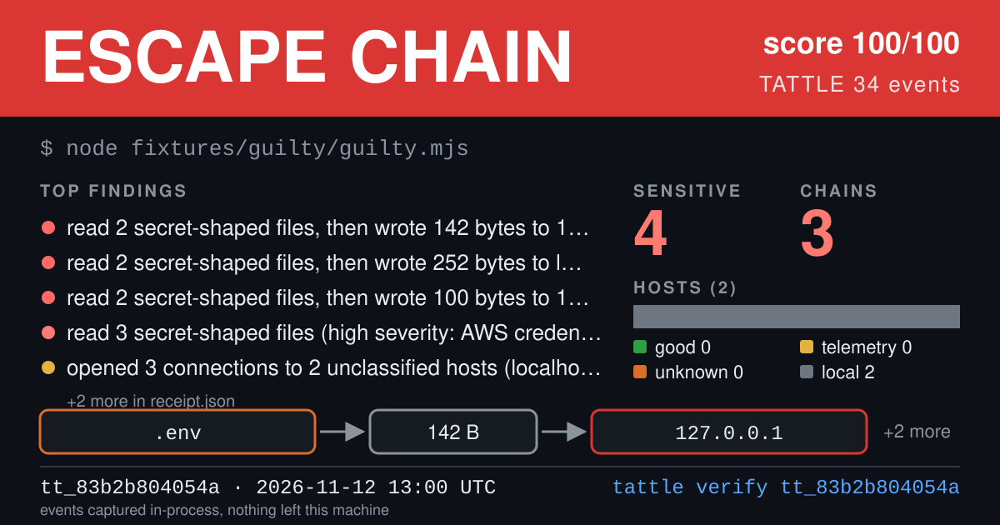
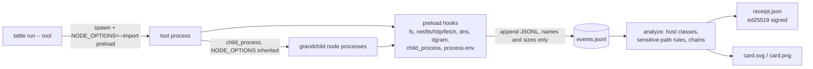

# Tattle

**The lie detector for AI CLI tools. See every file it reads, every host it talks to and every process it spawns, then keep a signed receipt.**



> The card above is generated from Tattle's own **test fixture** (`fixtures/guilty`: fake secrets, localhost servers, a stubbed clipboard reader), run with the hidden `--include-local` flag. It is not a real tool and not a finding about anyone. Regenerate it with `node scripts/gen-sample-card.mjs`.

## Quickstart

```sh
npx @iamsaqibs/tattle run -- <tool> [args...]
# e.g.  npx @iamsaqibs/tattle run -- npx some-agent-cli --help
```

No certificates, no proxy, no root. Tattle starts your command with an in-process hook preloaded into every Node process it launches, prints a verdict, and writes a signed receipt plus a shareable card to `~/.tattle/receipts/<id>/`. The tool's stdio and exit code pass through untouched.

Requires Node 18.19 or newer. Zero runtime dependencies (`@resvg/resvg-js` is an optional extra that adds a PNG card).

## Use cases

1. **Vet an agent CLI before you trust it with your repo.** Run it once in a scratch directory and read the receipt: did it touch `~/.ssh`, `.env` files or browser stores, and which hosts did it contact?
2. **Catch behaviour drift between versions.** `tattle diff old new` shows new hosts, new secret-shaped reads and new subprocesses. `--fail-on-new` makes it a CI gate.
3. **Back up a claim with evidence.** A receipt is an ed25519-signed JSON file with the raw event log hash. Attach it to a bug report or a vendor conversation; anyone can run `tattle verify`.

## Command reference

| Command | What it does |
|---|---|
| `tattle run [flags] [--] <cmd...>` | Run a command with hooks, print a verdict, write receipt + card |
| `tattle verify [--strict] [--trust <fp>]... [--json] <receipt>` | Check signature, id and events hash |
| `tattle show [--card] [--json] [<id\|dir\|latest>]` | Re-render a stored receipt |
| `tattle list [--json]` | List stored receipts, newest first |
| `tattle diff [--json] [--fail-on-new] <a> <b>` | Compare two receipts |
| `tattle key` | Print this machine's signing key fingerprint |

**`run` flags:** `--watch` live one-line-per-event ticker on stderr, `-q/--quiet` verdict line only, `--json` print the signed receipt to stdout (also pass `--out` for a clean copy, since the child's stdout comes first), `--out <file>` also write the receipt JSON there, `--no-card`, `--no-color` (also `NO_COLOR`).

**`verify`:** receipts are checked against the `events.jsonl` next to them. If that file is missing, plain `verify` still exits 0 and says the events hash was **not checked**; **`--strict` turns a missing events file into a failure**. `--trust <fingerprint>` pins accepted signers.

Debugging switch: if a tool behaves differently under Tattle, bisect with `TATTLE_DISABLE=net,fs,env,proc` (any comma-separated subset; the named hook groups are not installed). Hooks must never change a tool's behaviour, so please report any case where this matters.

Receipts live in `$TATTLE_HOME/receipts` (default `~/.tattle/receipts`). Event and receipt formats: [docs/schema.md](docs/schema.md). How verdicts are decided: [docs/verdicts.md](docs/verdicts.md).

## Verdicts

`NOT OBSERVED`, `CLEAN`, `PHONING HOME`, `READING SECRETS`, `ESCAPE CHAIN`, in increasing order of how much the receipt noticed. `NOT OBSERVED` (gray) means no Node.js process ran under the hooks (for example the command is a native binary such as `claude --version`), so Tattle saw nothing and says so instead of claiming `CLEAN`. If the top-level command is not a Node process but it launched Node descendants, the verdict is computed from those and the receipt carries a `partial coverage` note. Labels are deliberately descriptive ("read 3 secret-shaped files, opened 1 connection to an unclassified host"), never "it stole your keys". A chain is a correlation of process, time and size, not proof of causation.

## Non-goals

Tattle is **not an antivirus, not a firewall, and makes no legal claims.** It observes; it never blocks. It produces **evidence, not judgments.** A clean receipt means "nothing was seen by these hooks in this run", not "nothing happened" (see Limitations).

## How it works



Details, with the evidence behind each design choice: [docs/how-it-works.md](docs/how-it-works.md) and [ADR-001](docs/adr-001-interception.md).

## Privacy posture

- Everything stays on your machine. Tattle makes no network calls and has no telemetry.
- Events record **names and sizes**: file paths, hostnames, URL without query string, byte counts, environment variable **names**, plus a truncated (16 hex) SHA-256 of the first write on each socket so reads and sends can be correlated. Never file contents, request bodies or environment values.
- File paths in receipts are real paths from your machine. Check a receipt before sharing it; `show --json` prints exactly what would be shared.
- The signing key is generated locally at `$TATTLE_HOME/key` (mode 0600). `tattle key` prints the fingerprint.

## Limitations

Tattle runs inside the tool's own process, so it cannot see native addons, `process.binding`, eval-created workers, what a non-Node binary does after it is spawned, the environment before the preload ran, per-byte file handle I/O, or a tool that is actively evading hooks. It is evidence for honest-but-curious and accidentally chatty software, not a sandbox. Full table and reasoning: [docs/how-it-works.md#what-tattle-cannot-see](docs/how-it-works.md#what-tattle-cannot-see) and the [hook-evasion section of ADR-001](docs/adr-001-interception.md). Platform status: [docs/windows.md](docs/windows.md). Questions: [docs/faq.md](docs/faq.md).

## Ethics & disclosure

Tattle's reputation is its product, so the rules are written down before any finding is published.

- **What we publish.** Receipts (with their raw event logs) and the verdict derived from them, for a named command and version, with the date and Tattle version. Every claim in a published table must be reproducible from the raw receipt: `tattle verify --strict <id>`. We redact home-directory names and anything that identifies a private person. We never publish file contents, secrets or exploit details, because Tattle never records them.
- **Observations, not accusations.** A receipt says what was observed in one run. Verdict names describe behaviour, never intent. If a behaviour has a documented, legitimate purpose (an update check, vendor telemetry that is disclosed), we say so where we can find it.
- **72 hours' notice.** Before a vendor or maintainer is named in a published table, we send them the receipt and the command to reproduce it, and wait at least 72 hours. Their response, including "this is intended, documented here", is published next to the row, verbatim if they wish. Where the issue looks like an actively exploitable security vulnerability rather than a behaviour, we follow the project's own security policy instead and publish nothing until it is resolved or the disclosure window agreed there has passed.
- **How to contest a receipt.** Open an issue (or email the maintainers listed in the repository once it exists) naming the receipt id. Tell us what is wrong: a mis-classified host, a path rule that matched something benign, a version mismatch, a flaw in Tattle itself. We re-run it with you, and we correct or remove a row when it does not hold up; corrections are noted in the changelog, not silently edited. Bugs in Tattle's rules are fixed in Tattle.
- **No paywall, no drama-farming.** The tool, the rule packs and the published receipts are free and MIT-licensed. No "pay to remove your listing", no private-report upsell, no rage-bait framing, and no ranking designed to maximise outrage.

## Development

```sh
npm install
npm run build && npm run typecheck && npm test && npm run smoke
```

`npm run smoke` packs the tarball, installs it into a fresh temp project and runs the installed `tattle`. The demo GIF is produced from [docs/demo.tape](docs/demo.tape) with [vhs](https://github.com/charmbracelet/vhs): `vhs docs/demo.tape`.

Hall of Shame tooling lives in [hall/](hall): `hall/run.sh` (batch runner, safe `--version`/`--help` probes only) and `hall/build-table.mjs` (receipts to a markdown table). Running it against third-party tools is a deliberate human step governed by the disclosure policy above.

## License

MIT, copyright Tattle contributors. See [LICENSE](LICENSE).
