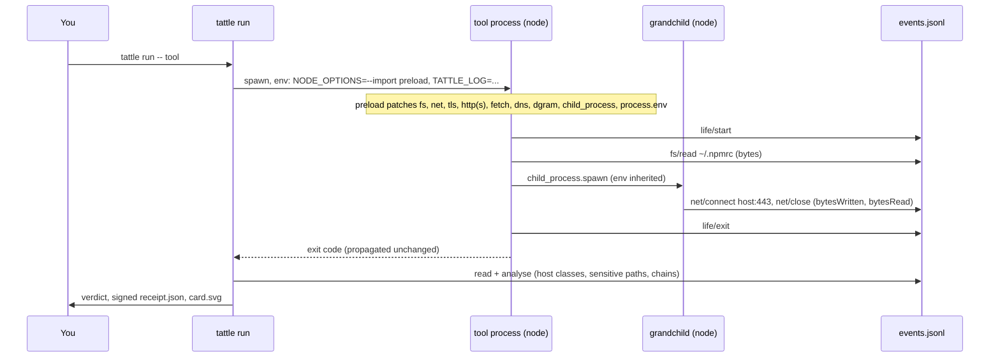

# How Tattle works

## The short version

`tattle run -- <cmd>` starts your command with `NODE_OPTIONS` extended by `--import <tattle>/dist/preload.js`. Every Node process in the tree (the tool, and any Node it spawns, including through shell scripts) loads that preload before the tool's own code. The preload wraps the builtin modules a Node program uses to touch the outside world and appends one JSON line per action to an event log. When the command exits, Tattle analyses the log, signs a receipt and draws a card.

Why a preload and not a proxy, a loader hook or ptrace: see [ADR-001](adr-001-interception.md). Short form: it needs no root, no certificates and no proxy configuration, it sees traffic before TLS, and it sees file and process activity that a network-level tool cannot.

## What is recorded

Names and sizes, never contents. A file read records the absolute path and byte count; a connection records `host:port` and exact bytes written and read at the socket; an HTTP(S) request records the URL without its query string and the method; a child process records argv; an environment read records the variable **name**. Full schema: [schema.md](schema.md).

## Privacy posture

- Local only. Tattle makes no network calls, sends nothing anywhere and has no telemetry.
- Values never leave the process: environment values, file contents and request bodies are not logged. The one derived value is a 16-hex-character SHA-256 prefix of the first write on a socket, used to correlate a read with a later send.
- Paths are real. A receipt contains absolute paths from your machine (for example your username in a home directory). Look at `tattle show --json` before sharing a receipt publicly.
- The signature proves a receipt was not edited after signing by the holder of a local key, and `--strict` verification proves it matches its event log. It does not prove the run was honest (see below), and a key you generated yourself says nothing about who you are.

## How a verdict is reached

Hosts are classed (the tool's own vendor and package registries, known telemetry, unknown, raw IP, loopback), file reads are matched against a rule pack of secret-shaped locations, and a read followed by a send is only called a chain when process, time window and byte size line up. The rules and thresholds are in [verdicts.md](verdicts.md); each finding points back to the raw event lines that support it.

## What Tattle cannot see

Tattle lives inside the tool's process and privilege domain. Absence of a finding is not proof of absence of behaviour.

| Blind spot | Why | Consequence |
|---|---|---|
| Native addons (`.node`) and `process.dlopen` | They call libc directly, below the JS APIs we wrap | A native addon can open files or sockets unseen |
| `process.binding(...)` / internal bindings | Reaches the raw binding, bypassing the public `fs`/`net` functions | Same: unseen |
| Workers created with `new Worker(code, { eval: true })` | They do not run the `--import` preload (measured on Node 22) | Activity inside eval workers is unseen. File-based workers are hooked |
| Non-Node programs a tool launches (Go, Rust, Python binaries, `curl`, `git`) | Only the spawn (argv) is observed, not what the program then does | `curl` and similar network tools are flagged by name as a heuristic, but their own file and socket activity is unseen |
| Environment before the preload ran | The OS handed the process its environment at `exec`; values inherited from the parent cannot be attributed, and reads before the preload starts are not seen | `env/read` shows JS reads of `process.env` after startup, names only |
| Reads through native code (`/proc/self/environ`, `environ` in an addon) | Not via `process.env` | Reading another process's `/proc/<pid>/environ` is flagged by a path rule; own-process native reads are not |
| Byte counts for file handles | `fs.promises.open()` handles and `openSync` + `readSync` record the open but not per-fd byte totals | Reads through handles appear without a size |
| Inbound connections | `net.Server` accepts do not call `Socket#connect` | A tool opening a listener is not recorded in v1 |
| Hook detection and evasion | The hook is monkey-patching in the same process. A hostile tool can inspect `Function.prototype.toString`, overwrite `NODE_OPTIONS`/`TATTLE_LOG`, spawn with a stripped environment, or call native code | Receipts are evidence for honest-but-curious and accidentally chatty tools and for supply-chain code not written to evade Tattle. They are not a sandbox |
| Hard kills | `SIGKILL` skips exit handlers, so still-open sockets are not flushed | Final byte counts for those sockets are lost |
| Concurrent environment reads inside one enumeration | Gets in the same synchronous turn as an enumeration are collapsed into one `env/enumerate` | A genuine single read in that same turn can be missed |

Everything above is also true of the receipt: it carries the same posture and Tattle does not claim more than it observed.

## Comparison with other approaches

We describe other tools only in general terms and only where we can speak to the category; we have not benchmarked them, and their current features may differ from this summary. If we have described your project unfairly, please open an issue and we will fix the text. These are all reasonable designs with different trade-offs, and several are better than Tattle at the thing they target.

| | Tattle | Proxy-based tools (e.g. redactai, egressor) | One-off harnesses (e.g. grok-monitor) |
|---|---|---|---|
| Observation point | Inside the Node process (JS API level) | Network wire, between the tool and the internet | Typically written for one tool or one question |
| Sees file reads and child processes | Yes, for JS-level APIs | Generally no: a network proxy sees traffic, not local files | Depends on the harness |
| Sees TLS content | Plaintext byte counts at the socket, URL and method; not bodies (by design) | Can inspect or alter content once a certificate is trusted | Depends |
| Setup | `npx @iamsaqibs/tattle run --`; no certs, proxy or root | Usually a trusted certificate and proxy settings, which some tools ignore or pin against | Per-tool setup |
| Works on any Node-based CLI | Yes | Yes if the tool honours the proxy | Usually that one tool |
| Can block or redact | No, by design: observe only | Often yes (that is the point of some of them) | Depends |
| Non-Node programs and native code | Not seen | Seen at the wire, if they honour the proxy | Depends |
| Resistant to a hostile tool | No | Better for traffic that must cross the proxy; evadable if the tool ignores it | Depends |
| Output | Signed, verifiable receipt and shareable card | Logs or filtered traffic | Usually logs |

They are complementary: if you need blocking or content redaction, use a proxy or firewall; if you want an inside-the-process record of what a Node tool touched, with a portable receipt, that is what Tattle is for.
